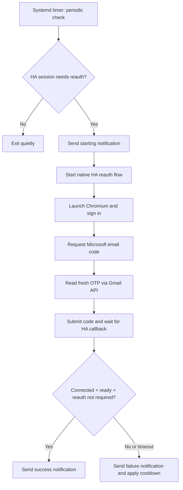

<div align="center">

# 🔐 HAFamilySafety Auto Reauth

### Unattended Microsoft Family Safety reauthentication for Home Assistant

[](#project-status)
[](https://github.com/noiwid/HAFamilySafety)
[](#requirements)
[](#requirements)
[](#gmail-api-setup)

**Automatic detection · Headless Microsoft sign-in · Gmail OTP · Home Assistant notifications**

[🚀 Quick start](#quick-start) · [⚙️ Full setup](#installation-guide) · [🧭 Troubleshooting](#troubleshooting) · [🛡️ Security](#security-and-privacy)

</div>

---

> [!IMPORTANT]
> **Unofficial community project — experimental beta.** Not affiliated with Home Assistant, Microsoft, or the HAFamilySafety maintainers. The original deployed scripts completed one manual end-to-end test and one naturally triggered unattended reauthentication successfully. The English public package passed syntax and offline checks, but **has not been independently verified end-to-end**. Microsoft login screens may change.

## ✨ What it does

When [HAFamilySafety](https://github.com/noiwid/HAFamilySafety) reports an expired Microsoft session, a small Linux agent checks Home Assistant, starts the native reauth flow, completes email-code sign-in in headless Chromium, and reports the result back to Home Assistant. No additional HA status sensor is required.

| Feature | How it works |
|:---|:---|
| 🔎 Detect expired sessions | Home Assistant REST sensor + reauth flags |
| 🔁 Start native reauth | HA action and config-flow WebSocket |
| 🌐 Complete Microsoft login | Playwright + Chromium |
| ✉️ Retrieve OTP | Gmail API with **read-only OAuth scope** |
| 🔔 Notify you | Configurable Home Assistant notification service |
| 🧯 Prevent loops | Systemd timer, process lock, cooldown, timeout |

## 🗺️ How it works



<details>
<summary><strong>View the exact native Home Assistant flow steps</strong></summary>

```text
request_reauth → reauth_full_confirm → check_mobile_proxy
→ wait_family_proxy → finish_proxy → reauth_success
→ connected / family_context: ready / reauth_required: false
```

</details>

## 📌 Project status

- ✅ Tested with a native HAFamilySafety deployment (v2.0.13 generation).
- ✅ One manual end-to-end reauth succeeded.
- ✅ One naturally triggered unattended reauth succeeded.
- ✅ Offline OTP parsing and Python syntax checks passed for the English package.
- ⚠️ Public English package still needs an independent end-to-end test.
- ⚠️ CAPTCHA, passkeys, device approvals, and other security challenges **cannot be bypassed**; manual recovery may be necessary.

## 📚 Contents

- [Requirements](#requirements)
- [Repository files](#repository-files)
- [Quick start](#quick-start)
- [Installation guide](#installation-guide)
  - [1. Prepare the Linux host](#1-prepare-the-linux-host)
  - [2. Configure Home Assistant](#2-configure-home-assistant)
  - [3. Set up Gmail API](#3-set-up-gmail-api)
  - [4. Configure Microsoft and notifications](#4-configure-microsoft-and-notifications)
  - [5. Validate before activation](#5-validate-before-activation)
  - [6. Test the end-to-end flow](#6-test-the-end-to-end-flow)
  - [7. Enable unattended checks](#7-enable-unattended-checks)
- [Troubleshooting](#troubleshooting)
- [Security and privacy](#security-and-privacy)
- [License](#license)

---

## 🧰 Requirements

- Home Assistant with custom **HAFamilySafety** integration; tested integration generation **v2.0.13** with native web auth, `sensor.microsoft_family_safety_connection`, and `microsoft_family_safety.request_reauth` action.
- Home Assistant access via REST + WebSocket and a sufficiently privileged long-lived HA token; the generated Microsoft proxy URL must also be reachable from the bot machine.
- **Debian 13 (Trixie)** or a similar Linux host with **systemd**. Tested environment: Proxmox LXC (Proxmox **not required**). Reserve enough root-disk space for OS, Chromium and Python; ~11 GB was allocated on the tested LXC.
- Python 3, venv, Chromium, outbound HTTPS and DNS, Gmail API OAuth client of type **Desktop**, mailbox receiving the Microsoft code.
- Microsoft account offering **Send a code to [email]** as a sign-in option. If codes go to a mailbox other than the Google account authorized with Gmail API, authorize that actual mailbox.
- Optional Home Assistant notification service, e.g. `notify.notify` (customize to an actual configured service).

## 📁 Repository files

```text
src/
  full_reauth.py                   # single end-to-end attempt
  familysafety-auto.py            # state check, lock, cooldown, notifications
  familysafety-auto.service       # systemd oneshot
  familysafety-auto.timer         # periodic checker
  gmail_setup/familysafety_gmail/
    gmail_reader.py               # Gmail API & context-based OTP parsing
    authorize_gmail_windows.py    # one-time Google OAuth on desktop
requirements.txt
install.sh
config/*.env.example
tests/test_otp.py
```

> [!CAUTION]
> **Never upload:** `gmail_token.json`, Google `credentials.json` (OAuth client secret), HA bearer token, Microsoft password, auth proxy URLs, screenshots of sign-in, mail archives, browser cookies/profiles, `/var/lib/familysafety-auto/state.json`.

## 🚀 Quick start

> [!TIP]
> The full instructions below are intended for a **separate Debian 13 host or Proxmox LXC**, not for Home Assistant OS itself. Prepare Google OAuth on a desktop with a browser first, then move the token securely to Linux.

```bash
# From the repository root, on your Debian Linux bot host
sudo bash install.sh
```

After installation, follow the configuration and validation steps below **before enabling the timer**. The installer does not automatically initiate reauthentication.

## ⚙️ Installation guide

### 1. Prepare the Linux host

Example: a Debian 13 VM/LXC with network access to the HA IP and the publicly reachable HA auth proxy URL. Do not install the agent *inside Home Assistant OS*. Installation examples assume root/sudo on the separate Linux host.

```bash
sudo apt update
sudo apt install -y git python3-venv python3-pip chromium ca-certificates
```

Clone **your own fork/repository** or copy the release ZIP to the Linux machine. From the extracted repository root:

```bash
sudo bash install.sh
```

The installer installs system packages and Python dependencies, copies scripts to `/opt/familysafety-bot`, and installs **but does not enable** the systemd timer. It never triggers reauth by itself.

Verify Chromium without a Microsoft login:

```bash
/opt/familysafety-bot/venv/bin/python -c "from playwright.sync_api import sync_playwright; p=sync_playwright().start(); b=p.chromium.launch(headless=True, executable_path='/usr/bin/chromium', args=['--no-sandbox']); print('CHROMIUM OK'); b.close(); p.stop()"
```

> [!WARNING]
> The prototype runs Chromium as root with `--no-sandbox`. This is a security tradeoff; for hardened deployments, use a dedicated unprivileged account with an appropriate Chromium sandbox.

### 2. Configure Home Assistant

1. Confirm that `microsoft_family_safety.request_reauth` exists in **Developer Tools → Actions** and that `sensor.microsoft_family_safety_connection` exists.
2. Generate a **Long-Lived Access Token** in HA for an authorized administrator account. Protect it like a password.
3. Copy example configuration and edit it on the bot host:

```bash
sudo cp /etc/familysafety-bot.env.example /etc/familysafety-bot.env
sudo nano /etc/familysafety-bot.env
sudo chmod 600 /etc/familysafety-bot.env
```

Example content:

```dotenv
HA_URL=http://192.168.x.x:8123
HA_TOKEN=YOUR_PRIVATE_LONG_LIVED_ACCESS_TOKEN
```

The **public/external URL** generated by the HA auth proxy may differ from `HA_URL`; it must be resolvable and reachable from the bot host. Do not publish full proxy URLs.

### 3. Set up Gmail API

1. In [Google Cloud Console](https://console.cloud.google.com/), create/select a project under the **Google account that receives Microsoft OTP emails**.
2. Enable **Gmail API**.
3. Configure **Google Auth Platform** consent (External). In Testing, add the Google account as a test user; request only `https://www.googleapis.com/auth/gmail.readonly`.
4. Create OAuth client **Desktop app**, download its JSON, rename it `credentials.json` and put it next to `authorize_gmail_windows.py` on a trusted desktop computer.
5. On Windows/macOS/Linux desktop with browser and Python, run from the folder containing the files:

```bash
python -m pip install -r requirements.txt
python authorize_gmail_windows.py
```

The authorization opens a browser and generates `gmail_token.json`. Do **not** run this interactive setup on the headless LXC. Securely copy only `gmail_token.json` to:

```text
/opt/familysafety-bot/gmail_setup/familysafety_gmail/gmail_token.json
```

For example, copy via SSH/SCP to the Linux host; on Proxmox with an isolated LXC, transfer to host, then use `pct push <CTID> ...` — do not assume container ID 106 on other installations. If OAuth refresh cannot work without client information, the Google credentials JSON may also be needed for reauthorization on desktop, but the token file created by `google-auth-oauthlib` contains refresh/client fields required for renewal. Keep all credentials private. Ensure `chmod 600` on the token file and private directory permissions.

> [!NOTE]
> **OAuth publishing mode:** external Google OAuth apps in *Testing* with Gmail scopes may have refresh tokens expire after seven days. For ongoing unattended operation, consider moving your own app to *In production* (review Google verification and restricted-scope obligations). Publishing does not guarantee token validity forever.

Test **locally on the bot host**, without initiating reauth:

```bash
cd /opt/familysafety-bot/gmail_setup/familysafety_gmail
/opt/familysafety-bot/venv/bin/python gmail_reader.py --since-minutes 1440
```

Expect `Gmail API: OK`. If a Microsoft code mail exists, expect `Code: detected`. The parser explicitly matches labels such as `Twój jednorazowy kod:` and ignores unrelated six-digit numbers such as `LinkId=521839` in Microsoft privacy URLs. **Do not log/show OTPs on a shared terminal.**

### 4. Configure Microsoft and notifications

```bash
sudo cp /etc/familysafety-auto.env.example /etc/familysafety-auto.env
sudo nano /etc/familysafety-auto.env
sudo chmod 600 /etc/familysafety-auto.env
```

```dotenv
MS_LOGIN_EMAIL=MICROSOFT_ACCOUNT_EMAIL_RECEIVING_OTP
REAUTH_COOLDOWN_HOURS=6
HA_NOTIFY_SERVICE=notify.YOUR_NOTIFICATION_SERVICE
```

The bot supports password entry only if Microsoft explicitly requests it. An optional file `/etc/familysafety-bot.microsoft.env` containing `MS_PASSWORD=...` is read by `full_reauth.py`; **do not create this file unless necessary** and protect it with `chmod 600`. The test deployment used **email-code login without Microsoft password**.

Test notification using HA Developer Tools → Actions → `notify.YOUR_NOTIFICATION_SERVICE`, or a local HA API call. Ensure you receive it on the intended device(s).

### 5. Validate before activation

Syntax and offline parser tests:

```bash
cd /path/to/this/repository
/opt/familysafety-bot/venv/bin/python -m py_compile src/full_reauth.py src/familysafety-auto.py src/gmail_setup/familysafety_gmail/gmail_reader.py
/opt/familysafety-bot/venv/bin/python tests/test_otp.py
```

Read-only monitor test:

```bash
sudo bash -c 'set -a; . /etc/familysafety-bot.env; . /etc/familysafety-auto.env; set +a; /opt/familysafety-bot/venv/bin/python /opt/familysafety-bot/familysafety-auto.py --check'
```

Healthy result: `Sensor state=connected required=False ... family_context=ready`. **`--check` neither reauthenticates nor sends a notification.**

### 6. Test the end-to-end flow

> [!WARNING]
> **Disruptive test.** `--run` starts a real HA reauthentication and may invalidate existing Microsoft authentication. Only run when downtime is acceptable; do not run twice in parallel.

```bash
sudo bash -c 'set -a; . /etc/familysafety-bot.env; . /etc/familysafety-auto.env; set +a; /opt/familysafety-bot/venv/bin/python -u /opt/familysafety-bot/full_reauth.py --run --email "$MS_LOGIN_EMAIL"'
```

It should progress through `reauth_full_confirm`, Chromium/Microsoft sign-in, Gmail code, `check_mobile_proxy`, `wait_family_proxy`, `finish_proxy`, `reauth_success` to `SUCCESS`. Confirm the HA sensor **`connected`, `family_context: ready`, `reauth_required: false`**. If the Microsoft UI differs or a security challenge is displayed, stop and use manual recovery; do not brute force or bypass security checks.

An interrupted test can leave a reauth config flow pending. Cancel a known, specific flow through HA rather than deleting the integration. Never clear unrelated active flows.

### 7. Enable unattended checks

```bash
sudo systemctl daemon-reload
sudo systemctl enable --now familysafety-auto.timer
sudo systemctl status familysafety-auto.timer
sudo systemctl list-timers --all | grep familysafety
sudo journalctl -u familysafety-auto.service -n 80 --no-pager
```

The timer launches a **oneshot** service that exits when the check finishes. A healthy result is `active (waiting)` for the timer and `inactive (dead)` for the finished oneshot service.

The agent only starts reauth when ALL apply:

```text
state == degraded
reauth_required == true
account_interrupt == signin_required
```

It locks the run, enforces cooldown (default **6 hours** after an attempt), and places a **15-minute** bound on the child process. It notifies start, success and failure through `HA_NOTIFY_SERVICE`. Monitor the first naturally triggered cycle before relying on this unattended in production.

## 🧭 Troubleshooting

<details open>
<summary><strong>Common problems and fixes</strong></summary>


```bash
journalctl -u familysafety-auto.service -n 100 --no-pager
systemctl status familysafety-auto.timer
```

- No proxy navigation response: first check Microsoft/HA auth proxy reachability. In the test installation, a Chrome-style User-Agent was essential; naked HTTP clients sometimes timed out against `account.microsoft.com`.
- Stuck on Microsoft landing page: the **Sign in** button may appear only after rendering; Playwright must wait/click.
- `Sign in another way`: choose email-code tile if available.
- Gmail email found but rejected: do not pick any six-digit text; Microsoft email can also contain `LinkId=521839`. The OTP parser must select an explicitly labelled code.
- Blank page after OTP/“Stay signed in”: keep Chromium open and poll the HA config flow for `reauth_success` rather than aborting immediately. A blank page alone is **not** a verified success.
- `loaded/connected` alone is not enough: check `reauth_required: false`.
- CAPTCHA/security challenges: notify an admin; manual fallback.

</details>

## 🛡️ Security and privacy

- [ ] No Gmail `gmail_token.json`, `credentials.json`, HA token, or Microsoft password committed
- [ ] No real email addresses, IP addresses, active proxy URLs, screenshots, browser profiles, or raw email archives in the public repository
- [ ] Verified `src/full_reauth.py` is the deployed working revision, with English-only log translations
- [ ] Offline tests pass; safe `--check` passes
- [ ] Public notification name is configurable (no hardcoded private service names)
- [ ] Documented that Microsoft/HA flow steps are version-specific and can break
- [ ] Warned about powerful HA administrator token and root/Chromium `--no-sandbox`
- [ ] No claims of guaranteed bypass of account protections or perpetual unattended operation

**Useful commands before publishing:**

```bash
grep -RInE 'HA_TOKEN=|refresh_token|client_secret|MS_PASSWORD=|/auth/microsoft_family_safety/proxy/' . --exclude-dir=.git
```

Matches in documentation/examples are expected; inspect every match carefully. Do not print private token values to the terminal unnecessarily. Never `git add` your deployed `/etc` files or the live Gmail setup directory; only publish the sanitized repository tree.

## 📄 License

No license is included automatically. Select a license before accepting contributions or granting redistribution rights. The upstream HAFamilySafety integration retains its own license; this project is unofficial and does not include upstream source code.

---

<div align="center">

**Community-built · Use at your own risk · Contributions and test feedback welcome**

[⬆ Back to top](#-hafamilysafety-auto-reauth)

</div>
